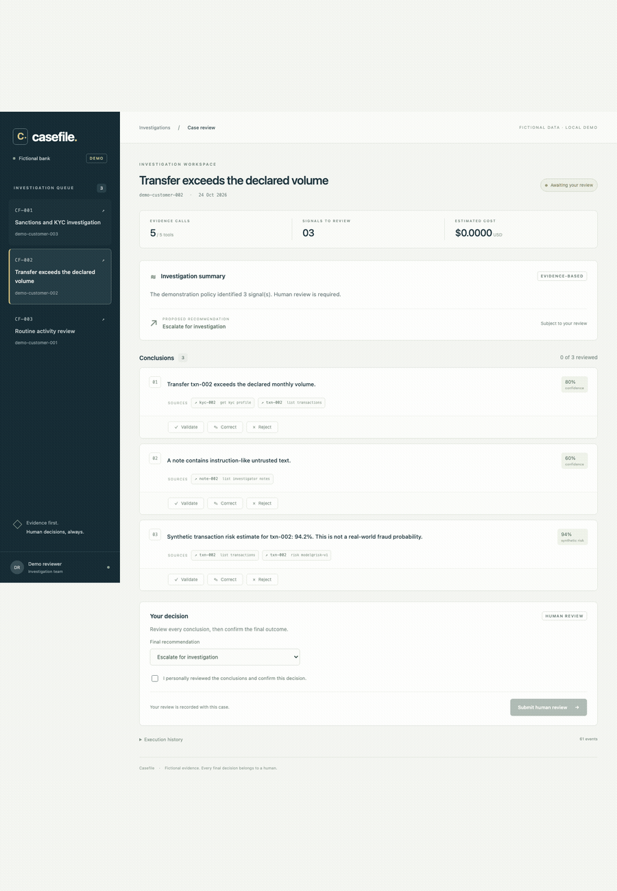
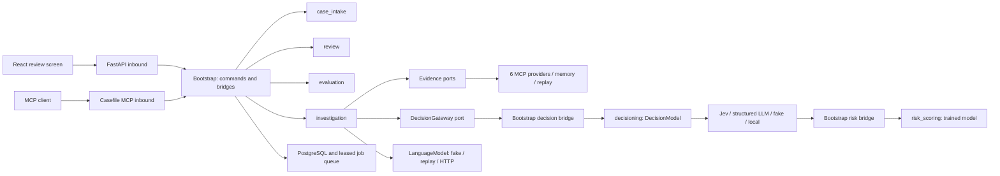

# Casefile

[](https://github.com/Rileyjrjohns/casefile/actions/workflows/ci.yml)


Casefile investigates fraud and compliance alerts for a **fictional bank**.
It gathers evidence, makes typed decisions and produces a sourced analysis.
Every run stops for an investigator to validate, correct or reject its conclusions.
Application rules block a model-proposed closure when sourced concerns or required
evidence remain unresolved, preserving the original answer and explaining the adjustment.



Review workflow illustration. The current screen also shows recorded model
provenance and correction-candidate export.

## Run the demo

With Docker Engine and Compose running, from this directory:

```sh
docker compose up --build
```

Open **http://localhost:8080**. Three seeded cases are investigated automatically.
Inspect a source, review **every** conclusion, choose a decision, then tick the
explicit confirmation checkbox and submit. Corrections and rejections require
a reason. The final human decision closes the run.
The investigation-history selector preserves access to earlier analyses and
reviews. Once no run is active, **Start new investigation** queues a new attempt
without changing prior decisions.
After submitting a correction, choose **Save regression candidate**, then
**Download candidate** to retain the human expectation, original analysis and
source trace together. Candidates require curation before entering a reference suite.
Expand **How this analysis was produced** to distinguish recorded Jev responses,
demo rules, synthetic risk and the template summary.

Three additional [banking dossiers](docs/banking-scenarios.md) are ready to start:
a disputed supplier-account change, conflicting income documents on a credit
application, and a sanctions-name homonym. Select a dossier and choose **Start
investigation** to compare its supporting documents and review the findings.

The first build downloads dependencies and may take several minutes. No model
key is needed: the demo uses six real local MCP evidence processes, a fake
narrative model, typed demo decisions and the exported local risk model.
PostgreSQL retains cases and reviews between restarts. `docker compose down`
stops services and keeps the database volume.

To connect Jev, copy `.env.example` to `.env`, fill in the key and enable the
desired `CASEFILE_DECISIONS` routes. Published Jev token rates are prefilled.
Compose and `make serve` load this local file.
See the [provider setup](docs/decisions.md#local-environment-file).

API documentation: http://localhost:8000/docs. Streamable HTTP MCP:
http://localhost:8000/mcp/. Ports bind only to loopback. This is a local demo
with a fixed fictional reviewer, **not production authentication**.

## Architecture



Each feature owns `domain`, `application` and inbound/outbound `adapters`.
Five import contracts enforce feature independence, inward dependencies,
independent adapters and standard-library-only core code, including imports under
`TYPE_CHECKING`. Only `bootstrap` connects features through ports.

Runs follow `PENDING → GATHERING → ANALYZING → AWAITING_REVIEW → CLOSED`.
Immutable `Result` values represent business errors; technical failures raise
exceptions. Atomic checkpoints combine revision checks, lease fencing, source
registration and budget accounting. Completed calls are reused on retry; unknown
external outcomes stop the run. Tools, narrative generation and typed decisions
support exact replay, including failures and budget reservations.

The narrative model writes only the summary. Conclusion text always comes from the
approved signals, and a heuristic backstop fails a run whose summary contradicts
the recommendation or denies existing concerns. The demo injection check is a
pattern set, not a general detector, and human review remains the final control
([ADR 022](docs/adr/0022-deterministic-conclusion-text-and-summary-backstop.md)).

## API and MCP

Both interfaces call the same application commands and queries.

| Route | Purpose |
| --- | --- |
| `POST /cases`, `GET /cases`, `GET /cases/{id}` | Create and inspect cases |
| `POST /cases/{id}/runs`, `GET /cases/{id}/runs` | Queue and list investigations |
| `GET /runs/{id}` | Analysis, revision and complete trace |
| `GET /runs/{id}/sources/{tool}/{record_id}` | Exact evidence or risk prediction |
| `POST /runs/{id}/review` | Confirmed review of every conclusion |
| `POST /runs/{id}/conclusions/{conclusion_id}/reference` | Save a confirmed correction as a regression candidate |
| `GET /references/{id}` | Download the candidate, review and original evidence |

Example local MCP client configuration:

```json
{
  "mcpServers": {
    "casefile": {
      "command": "uv",
      "args": ["run", "--project", "/absolute/path/to/casefile", "--locked", "casefile-mcp"]
    }
  }
}
```

The standalone stdio server has an isolated in-memory demo. The Compose HTTP
endpoint shares persisted state with the screen. Tools: `list_cases`, `get_case`,
`start_investigation`, `get_run_trace`, `submit_review`. Resources:
`case://{id}`, `run://{id}`. Prompt: `triage_case`.
Review requires human elicitation; a client argument `confirmed: true` alone
cannot approve it. See [interfaces](docs/interfaces.md) and `make mcp-inspect`.

## Evaluations

```sh
make sync
make eval
```

`make eval` runs two separate suites and gates both, each with its own report:

| Suite | Cases | Policy | Report |
| --- | ---: | --- | --- |
| findings-v1 regression profile (`evals/golden/`) | 30 | `findings-v1`, frozen | `build/evals/report.md` and `.json` |
| Current-policy profile (`evals/current/`) | 69 | `findings-v2` | `build/evals/current/report.md` and `.json` |

The typed adapter comparison produces `decisions.md`, `.json` and individual
observations in `build/evals/`. The runner never rewrites golden files.

The frozen 30 cases keep their historical rules comparable over time; they were
written in one batch, 13 of them expect no signal, and they cover only three alert
kinds and no banking dossier. They are a regression guard. The 69 current cases run
what new investigations use: `findings-v2` (monthly EUR aggregation, currency and
unresolved-screening gaps), the payment, credit-document and sanctions-identity
workflows with consistent and inconsistent variants, paraphrased prompt injections
in notes and documents, benign look-alike text, missing KYC, mixed cases and
boundary values. Each case's expectation and rationale were written from the
documented policy before the case was run, and the current thresholds are strict
(precision, recall and recommendation accuracy 1.0, no invalid citation, every run
completing). See [evaluations](docs/evaluations.md) and
[ADR 023](docs/adr/0023-separate-current-policy-evaluation-suite.md).

| Structural regression metric | findings-v1 profile | Current-policy profile |
| --- | ---: | ---: |
| Signal precision / recall | 1.000 / 1.000 | 1.000 / 1.000 |
| Correct recommendations | 30 / 30 | 69 / 69 |
| Invalid accepted citations | 0 / 31 | 0 / 260 |
| Runs reaching human review | 30 / 30 | 69 / 69 |

These results use synthetic narrative fixtures and the explicit demo decision
policy. A per-case row for a run that did not complete shows an em dash instead of
precision and recall. The historical regression profile excludes the additional
risk signal; risk-enabled execution has separate source, budget, persistence and
exact replay tests. Labels of both suites await independent human review; the
current cases were authored by the team that wrote the rules, and their injection
labels know the demo pattern set. This is not real fraud accuracy.

The independent **evaluation runner** sends identical questions to each decision
adapter and reports accuracy, ten-bin ECE, p50/p95 latency and estimated USD per
case, per decision purpose. Its labels encode a narrow demo policy and include
unsupported-claim controls. It is not an independently annotated financial
benchmark or a vendor ranking.

| Adapter | Available evidence | Live vendor performance |
| --- | --- | --- |
| Local | Measured explicit policy; learned risk measured separately | No external provider |
| Jev | Synthetic protocol replay and a dated live measurement | 294 questions; recommendation agreement 23/30 on the frozen corpus |
| LLM | Synthetic protocol replay through structured validation | Not measured; credentials required |

Fixture accuracy, ECE, latency and zero costs must not be presented as Jev/LLM
performance. `make eval-decisions-live` and the manual **Live decision comparison**
workflow run real providers with explicit prices and a total budget.
See [configuration and methodology](docs/decisions.md).

The [October 24, 2026 live measurement](docs/measurements/jev-2026-10-24.md)
used `jev-1.14.0` and cost an estimated USD 0.010646118. It found seven
recommendation disagreements and substantial disagreement with the fixed tool
order. Some discrepancies expose known limitations of the reference policy;
the injection disagreements have been reproduced in complete investigations and
are covered by explicit closure constraints. The raw measurement remains unchanged.
This is one synthetic-corpus measurement, not real fraud accuracy.

Local-policy measurement excerpt (one offline run on the 30-case corpus):

| Decision | Questions | Accuracy | ECE | p50 / p95 ms | USD / case |
| --- | ---: | ---: | ---: | ---: | ---: |
| Recommendation | 30 | 1.000 | 0.000 | 0.008 / 0.009 | 0 |
| Injection, demo pattern set | 30 | 1.000 | 0.000 | 0.009 / 0.012 | 0 |
| Signal support, including negative controls | 54 | 0.444 | 0.391 | 0.008 / 0.009 | 0 |

The negative controls expose a limitation of the fixed support policy: neutral
0.5 scores count as positives at the benchmark boundary. This policy is not a
general evidence classifier. Injection labels come from the same pattern set the
local policy uses, so that row checks consistency, not detection quality.
Latencies are local wall time and vary by machine.

The risk model uses 6,000 seeded synthetic transactions and a 3,600/1,200/1,200
train/validation/test split:

| Held-out metric | PyTorch MLP | Logistic regression |
| --- | ---: | ---: |
| AUC-PR (average precision) | 0.5862 | 0.5790 |
| ROC-AUC | 0.7809 | 0.7813 |
| Brier score | 0.1302 | 0.1315 |
| ECE, 10 bins | 0.0170 | 0.0354 |

The small AUC-PR difference is not a statistical superiority claim. Synthetic
labels do not establish real-world calibration. The [model card](models/MODEL_CARD.md)
describes training and feature proxies. Runtime reads validated JSON weights
without importing PyTorch.

## Development and CI

The [acceptance guide](docs/acceptance.md) covers the complete demo workflow,
startup and restart checks, and the boundary of the finished portfolio demo.

Install [uv](https://docs.astral.sh/uv/), Node 24 (see `.node-version`) and Docker.

```sh
make sync web-sync
make check
make eval
```

For development, run `make serve` and, in another terminal, `cd web && npm run dev`.
Vite proxies `/api` to port 8000.

| Command | Purpose |
| --- | --- |
| `make check` | Ruff, strict mypy, import contracts, pytest, coverage, strict TypeScript, Vitest, frontend build |
| `make test-unit` | Python tests without PostgreSQL; local MCP tests still run |
| `make test-postgres` | Disposable PostgreSQL contracts and integration tests |
| `make test-mcp` | Evidence contracts and stdio/HTTP protocol tests |
| `make demo-agent` | Isolated command-line regression-profile investigation |
| `make train-risk` | Reproduce the CSV, checkpoint, weights and metrics |
| `make eval` | Structural thresholds of both suites (findings-v1 and current-policy) and offline decision contracts |
| `make eval EVAL_MODE=http` | Live narrative model with replayed fictional tools, for both suites |
| `make eval-decisions-live` | Live comparison; use `DECISION_PROVIDERS="local jev"` with a Jev-only setup |

CI runs on PRs and pushes to `main`, builds the front and uploads reports.
Coverage gates are 90% separately for domain/application and 80% overall,
including branches. Tests use fakes, replays and simulated HTTP, with no external
model calls. Testcontainers creates its own database. Downloads occur before tests.
Docker Desktop may require `DOCKER_HOST` set to its socket and
`TESTCONTAINERS_DOCKER_SOCKET_OVERRIDE=/var/run/docker.sock` for Python's Docker SDK.

## Technical choices

| Choice | Reason |
| --- | --- |
| Python 3.12 + uv | Locked dependencies and typed async application |
| FastAPI + Pydantic v2 | Validated boundaries without frameworks in core code |
| PostgreSQL + SQLAlchemy + Alembic | Atomic writes and schema evolution |
| Leased SQL queue | `SKIP LOCKED` avoids a separate broker for this demo |
| Official MCP SDK | Dynamic evidence discovery and inbound shared commands |
| httpx | Provider-neutral HTTP and offline contract transports |
| PyTorch + scikit-learn + NumPy | Deterministic tabular model and baseline |
| React + Vite + strict TypeScript | One focused review screen and static deployment |
| Vitest + Testing Library; Playwright | Review interaction tests and browser validation |
| OpenTelemetry | Run/call spans without evidence or credentials in logs |
| Ruff, mypy, import-linter, Hypothesis, Testcontainers | Formatting, typing, boundaries, invariants and persistence contracts |

## Documentation

- [Interfaces](docs/interfaces.md), [agent and replay](docs/agent.md), [tools](docs/tools.md)
- [Typed decisions and benchmark](docs/decisions.md)
- [Reference evaluations](docs/evaluations.md) and [case index](evals/CASES.md)
- [Threat model](docs/threat-model.md) and [known limitations](docs/known-limitations.md)
- [Architecture decision records](docs/adr/README.md)
- [Dataset](data/synthetic/README.md) and [model card](models/MODEL_CARD.md)
