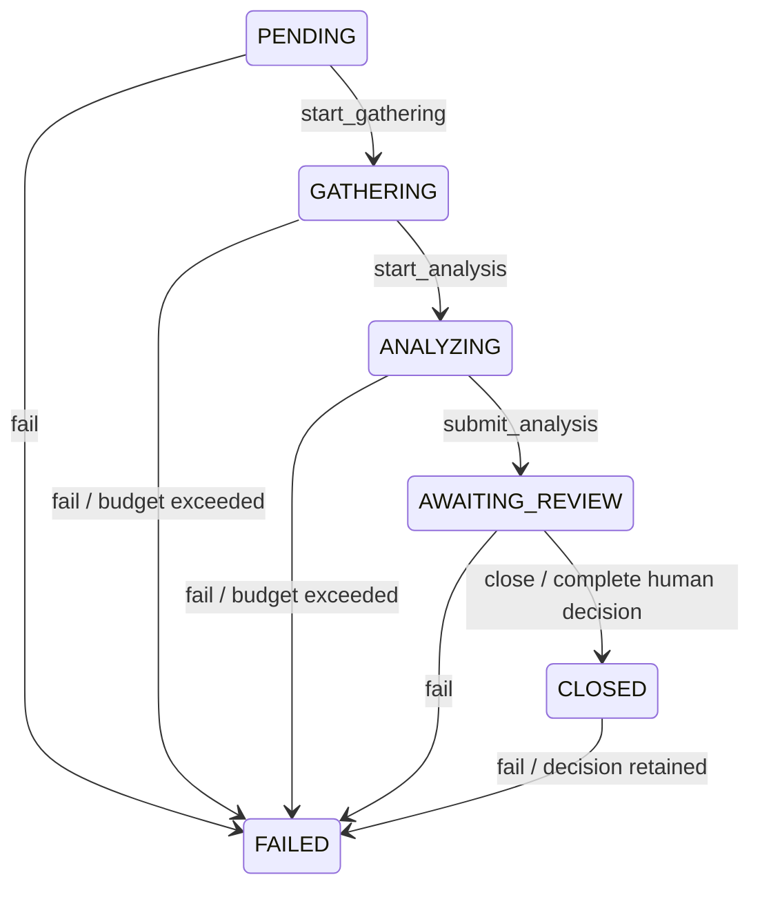

# ADR 003 — Run and review invariants

- Status: accepted
- Date: 2026-10-24

## Context

Use cases must be able to work with investigations that can be tested without
storage, tools or models. The same closure rules must apply to future HTTP and
MCP transports. The architecture forbids imports between the `investigation`
and `review` features.

## Decision

The investigation domain owns the `Run` aggregate, analyses, conclusions,
source references, confidence scores and budget. Validated data consists of
frozen dataclasses containing immutable values and tuples. An operation returns
a new object; a rejection leaves the original object intact and returns a
typed error.

UUID identifiers are nominal types in `shared/ids.py`. Callers supply identifiers
and timestamps; the domain generates neither UUIDs nor the current time.
Decision timestamps must include a time zone and are normalized to UTC.

### Transitions and closure

Business methods are explicit; no generic public transition allows the state
to be set arbitrarily. `close` requires a confirmed human decision receipt
for the same run, covering exactly its conclusion identifiers. The human
recommendation may differ from the analysis recommendation.

`FAILED` denotes an unsuccessful stop, without an automatic closure decision.
Under the rule allowing `FAILED` from every state, an already closed run may be
marked as failed, but its human decision is retained. Repeating `fail` on a
failed run preserves the first cause. An empty reason is rejected.

### Sources and budget

A reference identifies an exact tool and record. Two tools returning the same
ID do not identify the same source. A conclusion requires text, a finite
confidence score between 0 and 1, and a non-empty set of distinct references.
An analysis has a summary and unique conclusion identifiers; it may contain
no signals while still requiring human review.

References are registered only during `GATHERING`; duplicates are merged.
`submit_analysis` rejects any reference absent from that set. The application
must register only references actually returned by tools. The domain cannot
certify the origin of a reference supplied by a caller: tool schemas and full
provenance will be checked during agent integration.

Tool call, token and estimated cost limits are finite and non-negative.
Counters are integers. A zero limit is valid; reaching a limit exactly is
allowed. Cost uses `Decimal`, with the same currency unit throughout the run;
addition preserves the decimal precision of a small overrun.

`consume` accepts only non-negative increments during `GATHERING` or `ANALYZING`.
It preserves accumulated usage, including overruns, and returns the new run in
`FAILED` with the exceeded dimensions in the reason. The future orchestrator
must check this state and reserve budget before making external calls.
No tool execution is implemented here.

### Review and feature boundaries

The review domain owns its own `ConclusionReview`, `ReviewAction` and
`FinalDecision`. Each validation, correction or rejection preserves the original
text. A correction requires replacement text and a rationale; a rejection
requires a rationale. The review retains its author, timestamp, final decision
and every individual decision. Corrected text stays separate from the initial
analysis to preserve the history.

`Review.submit` requires explicit confirmation and exactly one decision per
expected conclusion, with no duplicates, additions or omissions. An empty
expected list is allowed and still requires human confirmation.

The review feature does not import investigation objects. Wiring in `bootstrap`
translates a review into a `HumanDecision` through use case ports. `RecordReview`
loads the expected list and original texts from the stored run, checks the
investigator's authorization and requests an atomic commit of the review and
run closure. In-memory and PostgreSQL adapters enforce this contract.
A confirmation boolean and an identifier alone are not proof of authentication:
transports must supply an authenticated identity separate from fields freely
submitted by the client.

## Alternatives considered

- Mutating run state directly makes rejections and snapshots harder to reason
  about and allows transitions to be bypassed.
- Sharing every business object through `shared` obscures the boundary between
  investigation and review; only identifiers and generic mechanisms belong there.
- Allowing partial reviews at closure risks leaving a conclusion without a
  decision. Submission is complete; a future UI draft can be added separately.

## Consequences

The domain is deterministic and has no third-party dependencies. Tests cover
the full transition matrix and use Hypothesis for scores, budgets, operation
sequences and sets of reviewed conclusions. Use cases now handle revision
conflicts and correction promotion. PostgreSQL adapters provide durable
persistence and checks across connections. Authentication remains the
responsibility of future inbound adapters.
