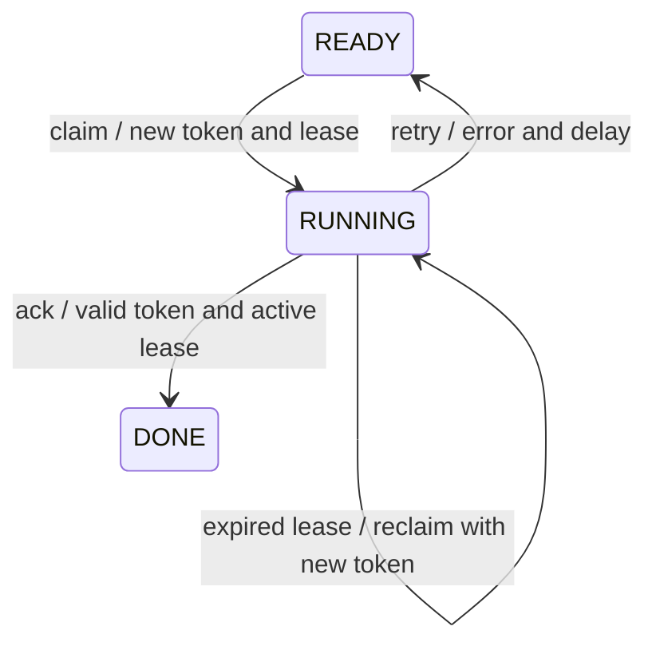

# ADR 005 — PostgreSQL job queue with lease-based claims

- Status: accepted
- Date: 2026-10-24

## Context

Creating a run and then publishing a message to another system introduces a
dual write. For Casefile's initial volume, PostgreSQL can store the run and its
execution intent in a single transaction while supporting multiple independent
workers.

## Decision

`RunStore.enqueue` inserts the run and a `READY` job in the same transaction.
`run_jobs.run_id` is both a primary key and a foreign key to `runs`. The partial
unique index on active runs and key constraints guarantee uniqueness even when
multiple connections start runs for the same case.

The `JobQueue` port exposes `claim`, `ack` and `retry`. `claim` selects a ready
job or one with an expired lease using `FOR UPDATE SKIP LOCKED`, ordered by
availability time and then identifier. The transaction moves the job to
`RUNNING`, increments the attempt number and records a UUID token and an
expiration time, then ends. No transaction stays open during an executor call.

Lease and retry timestamps come from the PostgreSQL clock. `ack` and `retry`
check the state, token and expiration time in their queries. A stale owner
receives `False`; it cannot acknowledge or reschedule another worker's job.
Acknowledging a job does not close the run: normal execution may have reached
`AWAITING_REVIEW`, awaiting a human decision.

`RunWorker.run_once` handles at most one job using an injected `RunExecutor`.
It bounds execution time below the lease duration. On a technical exception,
it reschedules its job, records the error type and propagates the exception
to the supervisor. Cancellation or process termination leaves the lease to
expire. If ownership is lost, the worker raises `LeaseLostError`.

Delivery is at least once. Aggregate updates must use revisions; future
external calls must be idempotent or carry deduplication identifiers. The token
protects queue operations, not external effects from an executor that ignores
cancellation. The current implementation provides no guarantee of exactly-once
execution.

## Alternatives considered

- An external queue would require a transactional outbox and a relay, adding
  infrastructure to operate before that need has been measured.
- Holding a SQL lock throughout an investigation would tie up a connection
  and transaction during tool and model calls.
- Permanently removing a job at `claim` time would lose the work if the worker
  stopped before acknowledging it.

## Consequences and limitations

The queue uses the persistence infrastructure already required. Short
transactions allow concurrent consumption. `SKIP LOCKED` accepts an incomplete
view of locked rows, which suits a queue; it does not guarantee strict FIFO
ordering across workers. See the
[PostgreSQL SELECT documentation](https://www.postgresql.org/docs/18/sql-select.html).

Attempts are counted but not capped at this stage. Quarantine policies,
attempt limits, lease renewal for long executions, the polling process and
completed-job cleanup will be defined when operating the agent. Current
defaults are a 60-second lease, a 30-second execution timeout and a 5-second
retry delay.

Tests run the same contracts against memory and PostgreSQL, then verify
parallel claims, already locked rows, expired lease recovery and rejection
of stale owners on PostgreSQL. A trigger that rejects job insertion demonstrates
rollback of the associated run.
